# ParryDuel

敵の攻撃を、当たる瞬間に弾く。よろけた所へ反撃して、3 体を倒す。ブラウザで開くだけで遊べる、1 回 2〜4 分の 1 対 1 のゲームです。

**遊ぶ: https://takosasi-dev.github.io/parry-duel/** (デスクトップのブラウザ向け、インストール不要)

<p align="center">
  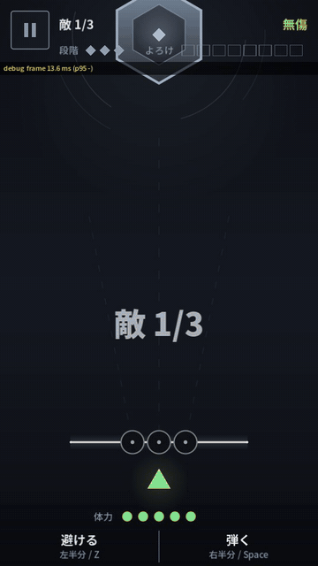
</p>

> v0.3.0。判定の窓などの調整値は、まだ人に遊んでもらって決めた値ではありません。遊んだ結果を見て変えることがあります。

## 遊び方

操作は 2 つだけです。自分から攻める操作はありません。

| | マウス・タッチ | キーボード | ゲームパッド |
|---|---|---|---|
| **弾く** | 画面の右半分を押す | スペース / X | A / RB / 右の引き金 |
| **避ける** | 画面の左半分を押す | Z / 左シフト | B / LB / 左の引き金 |
| 一時停止 | 左上のボタン | Esc | Start |

ゲームパッドのメニューは、十字キーで選んで A で押し、B で戻ります(偽のパッドを使った自動の確認だけで、本物のパッドではまだ確かめていません)。

- **白い丸**は、線に届く瞬間に**弾く**。ぴったり合うほど、敵のよろけが大きく溜まります。
- **赤い三角**は弾けません。届く前に**避ける**。
- 何も無い所で弾くと空振りになり、0.45 秒のあいだ動けません。連打は通りません。
- よろけが溜まると、敵が傾いて「いま!」と出ます。そこで弾くと**反撃**が入り、敵は次の段階へ進みます。3 段階で 1 体、3 体で 1 回です。
- 敵ごとに新しい物が 1 つ増えます(速さの違い → 途中で止まる「ため」 → 赤)。最初の 1 回は、当たっても体力が減らない形で出ます。
- 受けた数が少ないほど、同じなら時間が短いほど、良い記録です。

<p>
  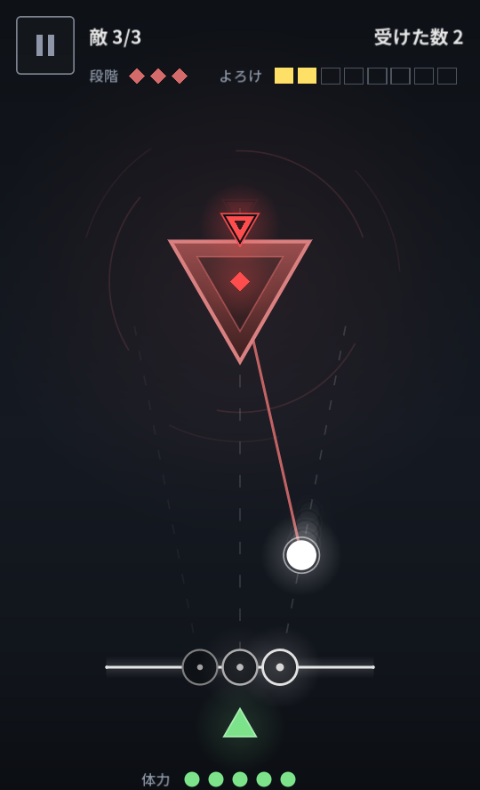
  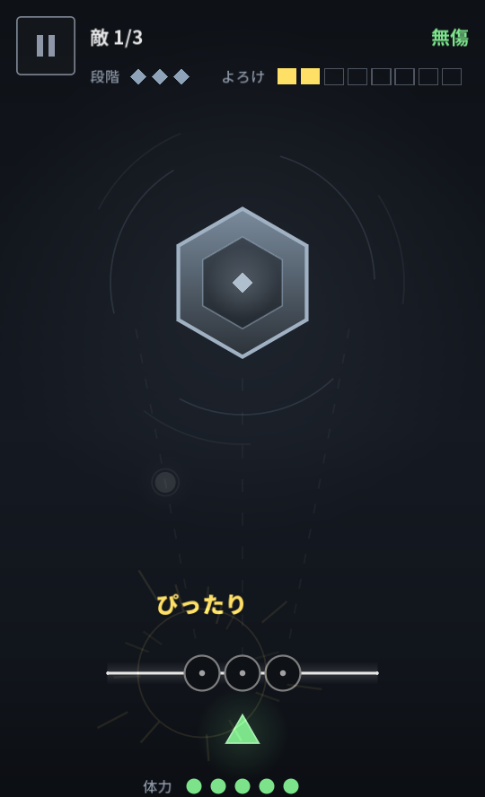
  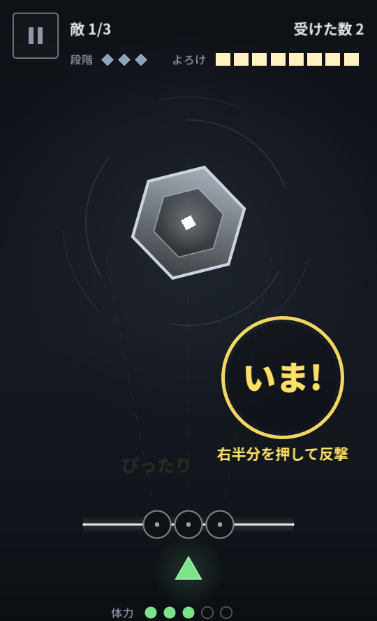
</p>

白と赤は、色だけでなく形(丸と三角)でも見分けられます。同じ場面を白黒にした物:

<p>
  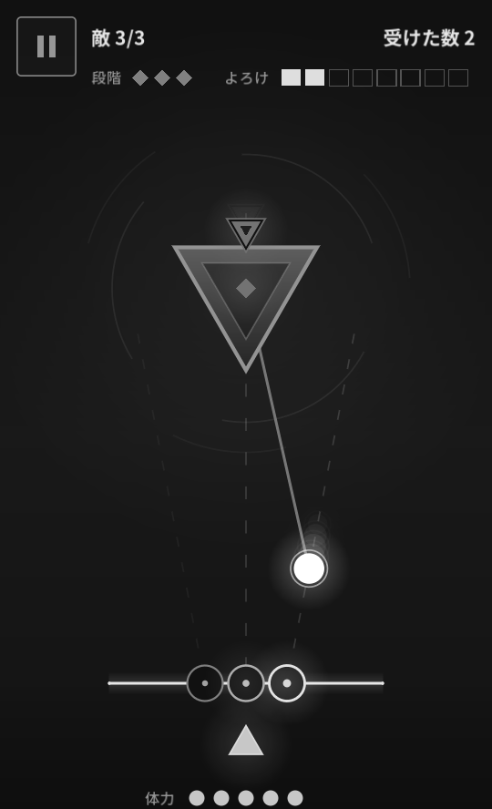
</p>

入口は「いつもの3連戦」(毎回同じ)と「今日の3連戦」(日付で決まり、同じ日なら誰でも同じ型が同じ順に出る)の 2 つです。着いたことのある敵は、1 体だけの練習もできます(記録には残りません)。「型の練習」では、苦手な型を 1 つ選んで繰り返せます。体力は減らず、「ゆっくり」(0.75 倍の速さ)にもできます。

敵 3 に着くと「終わらない連戦」で遊べます。敵 1〜3 を繰り返し、1 周ごとに攻撃が速くなります(上限 1.25 倍)。体力は持ち越しで、1 体倒すごとに 1 戻ります。倒した数を競います。実績は 14 個あり、タイトルの「実績」で一覧を見られます。結果の画面の文字をコピーして貼れば、受けた数と時間を比べられます。

<p>
  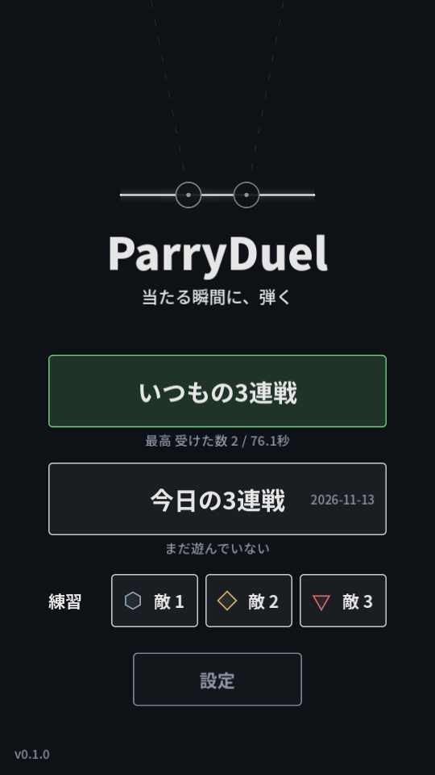
  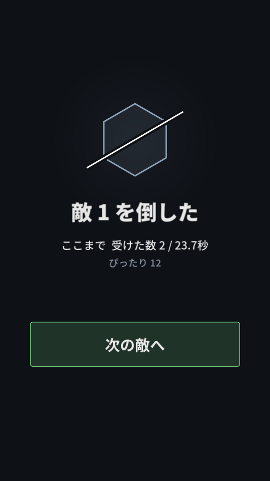
  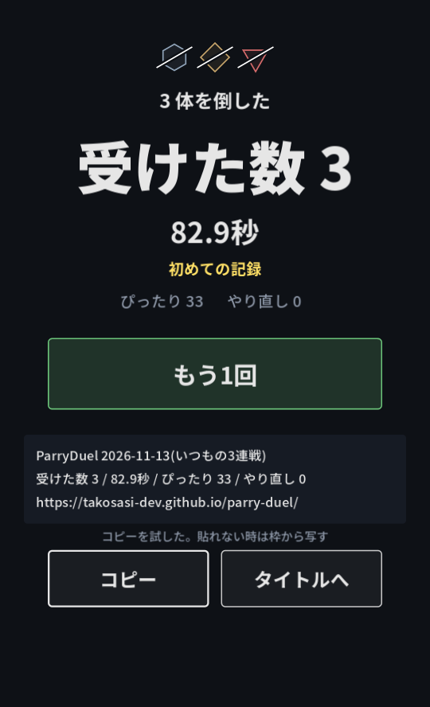
</p>
<p>
  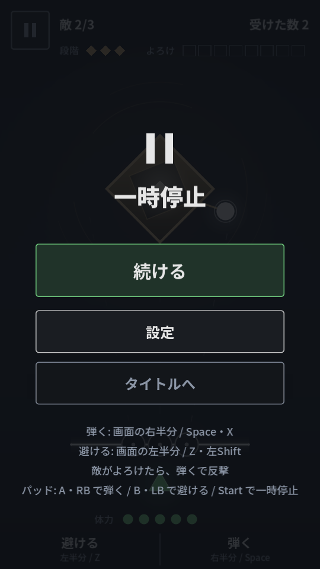
  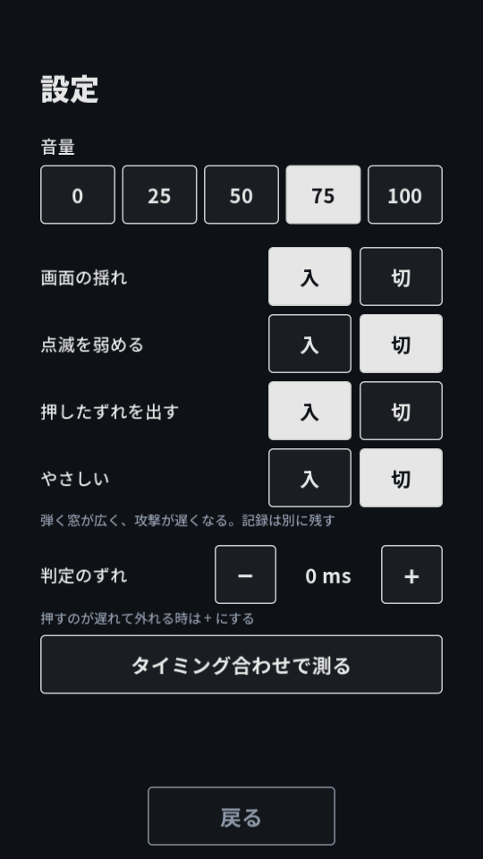
  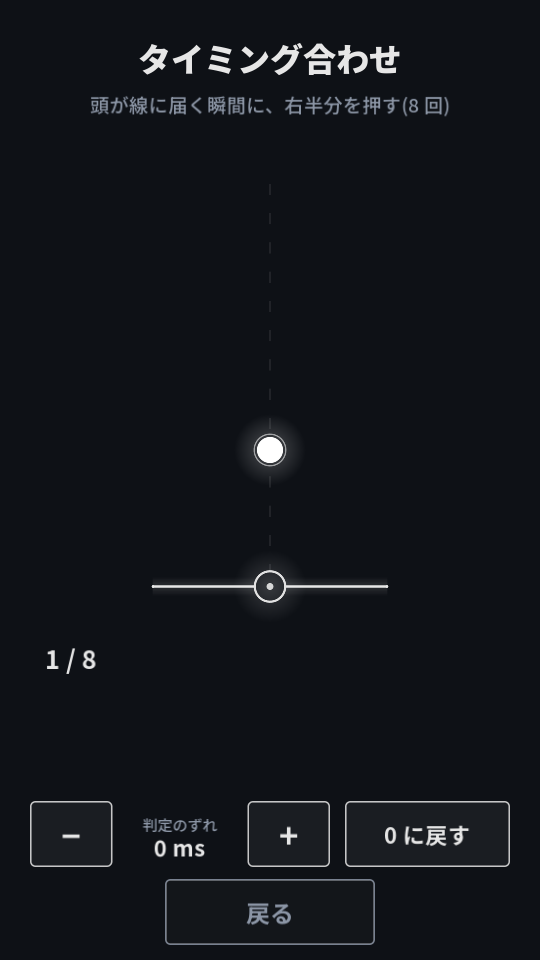
  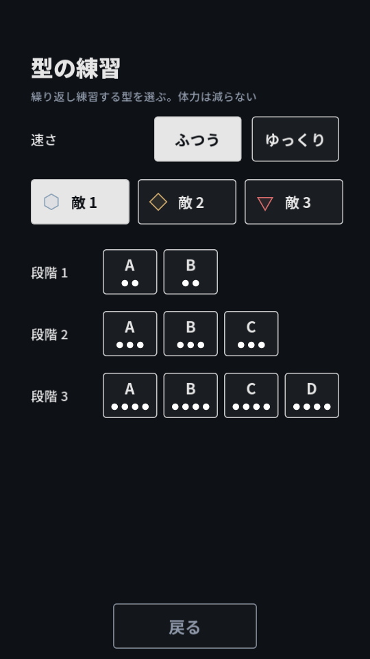
  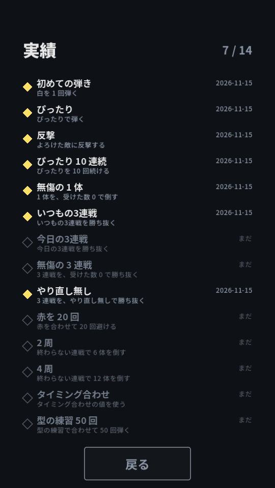
</p>

## 判定の決まり

- 時間は 1/120 秒の刻み(tick)の整数で数えます。見た目と判定は同じ tick で動くので、端末やフレームレートが違っても、同じ時に押せば同じ結果になります。
- 当たる時刻は「頭が弾く線に届く時」です。頭は等速でまっすぐ動きます(「ため」は途中で止まり、また動きます)。
- 当たる時刻との差が ±12 tick(±100 ms)なら弾き、±5 tick(±約 42 ms)なら「ぴったり」です。早くても遅くても、窓の中なら成功します。
- 避けるは、押してから 30 tick(0.25 秒)の間、当たりません。
- 画面やキーボードの遅れは、人と環境で違います。設定の「判定のずれ」(−100〜+100 ms)で動かせます。「タイミング合わせ」で 8 回押すと、合う値を出します。
- 弾くたびに、どちらへ何 ms ずれたかが出ます(設定で消せる)。結果の画面には押す癖の平均が出て、大きくずれている時は「判定のずれ」をその値にするボタンが出ます。
- 設定の「やさしい」を入れると、弾く窓が ±150 ms に広がり、攻撃が 0.8 倍の速さになります。記録は別に残ります。
- 音は手がかりの 1 つで、音量 0 でも見た目だけで遊べます。画面の揺れを切る・点滅を弱める設定もあります。

数値はすべて `core/balance.gd` にあります。

## 保存と通信

保存はブラウザの中(localStorage)だけです(記録と設定)。サーバーとの通信・アクセス解析・広告はありません。シークレットモードでは記録が残りません。

## 動作環境

- Godot 4.7.2-stable(GDScript、レンダラー Compatibility)
- Web 書き出しはスレッド無し・拡張無し
- 動作を確かめたのはデスクトップの Chrome と Edge です(Firefox は、まだ確かめていません)。スマホのブラウザは、動かして記録しているだけです

## 開発

Godot の実行ファイルの場所を、環境変数 `GODOT` に入れます(無ければ PATH の `godot`)。どれも窓を出しません。

```
# 取り込み(最初に 1 回)・テスト(全件成功で終了コード 0)・Web 書き出し(build/web/。書き出しテンプレート 4.7.2 が要る)
python tools/gd.py import
python tools/gd.py test
python tools/gd.py export

# ブラウザでの自動の確認(Web 書き出しの後。窓なし・消音・使い捨てのプロフィールの Chrome と Edge を使う。Node.js 22 以上)
# 環境変数 PD_URL に公開した URL を入れると、手元の書き出しの代わりに、その URL を確かめる
node tests/web_drive.mjs --all
node tests/web_drive.mjs --play key      # 1 つだけ回す。モードの一覧は、ファイルの頭にある

# 字体の部分集合を作り直す(文言を足した後)・効果音を作り直す・BGM を作り直す(ffmpeg が要る)
python tools/subset_font.py
python tools/gen_sfx.py
python tools/gen_bgm.py
```

`main` に push すると、GitHub Actions(`.github/workflows/pages.yml`)がテスト・Web 書き出し・GitHub Pages への配置を行います。テストが落ちたら配置しません。書き出した物(`build/`)はコミットしません。変更の記録は [CHANGELOG.md](CHANGELOG.md)。

### フォルダの構成

```
core/     画面に依存しない決まり(判定・対戦の進み・型の検査・記録・日付)。調整値は balance.gd、文言は strings.gd
data/     型 30 個(patterns.json)
ui/       画面(タイトル・対戦・合間・結果・設定・タイミング合わせ・一時停止・型の練習)と演出
save/     ブラウザ内への保存
audio/    効果音と BGM の再生
assets/   字体と効果音と BGM
tests/    テスト(run_tests.gd)と、ブラウザでの自動の確認(web_drive.mjs・web/)
tools/    窓なしで回す入口(gd.py)、字体・効果音・BGM・アイコンを作るスクリプト
docs/     README の画像
```

判定の決まりは `core/judge.gd` にだけ、頭の位置の式は `core/attack.gd` にだけあります。画面は、それを読んで描くだけです。

## ライセンス

コードは [MIT](LICENSE)。効果音は `tools/gen_sfx.py`、BGM は `tools/gen_bgm.py` で作った自作です。同梱の字体(Noto Sans JP の部分集合)は SIL Open Font License 1.1 です。Godot Engine の表示を含め、詳しくは [THIRD-PARTY-NOTICES.md](THIRD-PARTY-NOTICES.md)。

<!-- takosasi-dev line: the sign and the links follow https://github.com/takosasi-dev/takosasi-dev -->
<p align="center">
<a href="https://github.com/takosasi-dev"></a><br>
<a href="https://takosasi-dev.github.io/takosasi-dev/line/?from=parry-duel&amp;go=prev">◀ 前の駅</a> ・ <a href="https://github.com/takosasi-dev">路線図</a> ・ <a href="https://takosasi-dev.github.io/takosasi-dev/line/?from=parry-duel&amp;go=next">次の駅 ▶</a>
</p>
